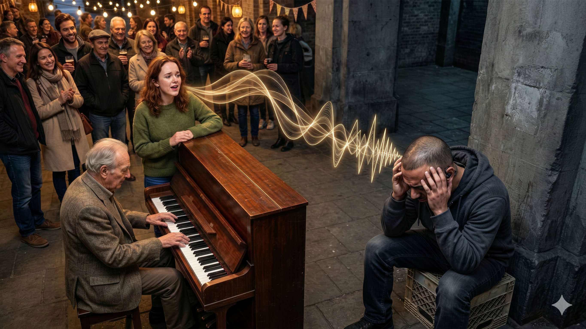

# 해용-전.md

한글 버전

# 영화 제목 : 

<<사운드 오브 메탈>>

# 줄거리 : 

메탈 음악 밴드의 드러머인 주인공은 어느날 돌발성 난청을 겪고 청각을 잃게 된다. 한 멤버가 청각 장애인을 보살펴주는 교회 소속의 어느 단체를 소개해준다. 주인공은 그곳에서 생활하면서 점차 어울리고, 또 수화도 배우고 하는 등 장애인으로서 새로운 삶들을 살아가게 된다. 또한 그곳의 다른 청각 장애인들과 유대감을 쌓아 나간다. 하지만 여전히 장애를 고쳐야 할 대상으로 본 그는 의사를 만나 수술을 하게 된다. 그는 수술 후 소리를 되찾지만, 예전의 소리가 아니었다. 머리 뒤에 부착된 마이크로 소리를 귀 대신 받는 방식이기에 주인공은 해당 소리에 대해 낯설어하고 실망하게 된다. 여자친구를 다시 만난 후 파티에 참석한 그는 여전히 지지직 거리는 마이크 소리로 사람들의 대화 소리를 듣고, 노래 소리를 들으며, 그렇게 그 소리들에 적응하며 살아가는 모습을 보여주고 이 이야기는 끝이 난다. 

# 영화에 사용된 음악 : 

    Chamber of Hel 아브라함 마더(Abraham Marder, 1983– ), 리즈 아메드(Riz Ahmed, 1982– ), 올리비아 쿡(Olivia Cooke, 1993– ) : 
    
    강렬한 메탈 음악으로 해당 곡이 들리는 도중에 순간적으로 소리가 멈추고 보컬의 입모양이 움직이는 장면만 보여준다. 해당 곡은 메탈과 같이 상당히 강하고 볼륨이 센 소리와 이후의 침묵을 대비시킴으로써 주인공의 청각 장애를 보여준다.   
    
    Cet Anneau D'or 마르그리트 모노 (Marguerite Monnot, 1903–1961), 르네 루자 (René Rouzaud, 1905–1976) : 
    
    해당 곡은 극의 마지막에 주인공의 여자친구와 그녀의 아버지가 함께 부르는 샹송이다. 해당 곡은 처음에 굉장히 아름답게 들리지만, 주인공에게는 그렇지 않다. 주인공은 청각 장애를 극복하기 위해 인공적인 장치를 뒤통수에 달았는데, 이를 통해 듣는 소리는 우리의 실제 귀가 듣는 것과는 달리 낯설게 느껴진다. 약간 저음질 마이크의 지직거리는 소리와 함께 그녀의 목소리도 갈라져 아름답지 않게 느껴진다. 이러한 대비를 통해 주인공이 청각 장애를 완전히 고치지 못하고, 앞으로도 해당 소리들에 적응해서 살아가야 한다는 사실을 보여준다. 
    
# 음악이 작품 속 장애를 묘사하는 방식

  해당 영화는 청각 장애를 가지게 된 한 음악인의 인생의 단편을 그린 영화이다. 이 작품에서 음악은 주인공이 가지고 있는 장애를 극적으로 대비해주는 역할을 한다. 주인공은 락 밴드의 가수로서 상당히 시끄러운 환경에서 드럼을 치면서 공연을 한다. 그러나 이후 갑자기 소리가 모두 들리지 않게 되는 장면이 대비되면서 다른 사람들이 바라보는 세상과 주인공이 바라보는 세상의 극적인 대비를 보여준다. 또한 다양한 소리를 활용하였는데, 초반에 청력이 약간 남아있을 때 완전 묵음처리하기 보다는 사람의 소리를 좀 먹먹하게 표현하였고, 살짝 살짝 들리는데, 무슨 말을 하는지에 대해서는 약간 추론을 해야 할 정도로 잘 안들리게 표현하였다. 또한 영화 전반적으로 상당히 묵음처리가 많이 되어 있었으며, 그로 인해 청각장애인이 가지는 고충을 잘 표현할 수 있었던 것 같다. 또한 주인공은 수화를 배우고, 피아노 소리를 듣고자 할 때 피아노에 손을 갖다 댐으로써 진동을 느끼는 방식으로 주인공이 청각 장애를 가지고 있음을 암시했다. 그러나 이는 청각장애를 가진 사람들도 다른 감각들을 활용해 음악을 들을 수 있다는 뜻으로 해석되므로, 음악을 꼭 귀로만 들을 필요는 없다는 것을 보여준다. 또한 청각장애를 가지고 있다고 해서 음악을 듣지 못하는 것은 아니라는 점을 또한 보여주게 된다. 마지막으로 주인공이 수술 후 소리를 들을 때 우리가 일반적으로 듣는 목소리가 아닌 상당히 저품질 마이크를 통해 소리를 출력한 느낌을 표현하였다. 그래서 통화품질이 매우 나쁜 휴대폰으로 통화하는 느낌이 들었다. 그리고 메탈 음악을 주로 하는 사람으로 묘사되는데, 공연장에서 큰 소음을 견디지 못하고 뛰쳐나가는 장면도 있었다. 해당 작품과 같이 돌발성 난청에 대해 묘사한 영화인 [코다] 를 같이 보면 좋다. (./hong-jiseul.md). 
  Marguerite Monno, René Rouzaud [ Cet Anneau D'or ],(https://www.youtube.com/watch?v=Q7wa5O1m4qI&t=143s)

# Haeyong-Jen.md

# Movie Title: 

*Sound of Metal*

English version

# Synopsis: 

The protagonist, a drummer in a metal band, one day experiences sudden sensorineural hearing loss and loses his hearing. A band member introduces him to a church-affiliated organization that cares for people with hearing impairments. Living there, the protagonist gradually fits in, learns sign language, and starts a new life as a person with a disability. He also builds bonds with the other deaf residents there. However, still viewing his disability as something that needs to be fixed, he meets with a doctor and undergoes surgery. After the surgery, he regains his hearing, but it is not the same sound as before. Because the system picks up sound through a microphone attached to the back of his head instead of his ears, the protagonist feels unfamiliar with and disappointed by the sound. After reuniting with his girlfriend and attending a party, he listens to people's conversations and singing through the still-crackling microphone, and the story ends showing him adapting to and living with those sounds.
# Music used in the film:

    1. Chamber of Hel by Abraham Marder (1983–), Riz Ahmed (1982–), and Olivia Cooke (1993–): 
    
    This intense metal track features a moment where the sound suddenly cuts out, leaving only a shot of the vocalist’s mouth moving. By contrasting the song’s powerful, loud metal sound with the ensuing silence, the film illustrates the protagonist’s hearing impairment. 
    
    2. Cet Anneau D’or by Marguerite Monnot (1903–1961) and René Rouzaud (1905–1976): 
    
    This chanson is sung by the protagonist’s girlfriend and her father together at the end of the play. Although the song sounds incredibly beautiful at first, this is not the case for the protagonist. To overcome his hearing impairment, the protagonist has an artificial device attached to the back of his head, and the sounds he hears through it feel unfamiliar—unlike what our actual ears hear. Accompanied by the crackling sound of a low-quality microphone, her voice also sounds hoarse and unattractive. This contrast illustrates that the protagonist has not fully overcome his hearing impairment and must continue to adapt to these sounds as he goes about his life. 
# How Music Depicts Disability in the Film

   This film depicts a slice of life of a musician who develops a hearing impairment. In this work, music serves to dramatically contrast with the protagonist's disability. As a singer and drummer in a rock band, the protagonist performs in an extremely loud environment. However, when this is contrasted with a sudden scene where all sound disappears, it highlights the stark contrast between the world perceived by others and the world experienced by the protagonist.

The film also utilizes a variety of sound techniques. In the early stages, when the protagonist still has a small amount of residual hearing, human voices are rendered muffled rather than completely muted—faintly audible, yet indistinct enough that the viewer has to infer what is being said. Furthermore, extensive use of silence throughout the film effectively conveys the struggles faced by people with hearing impairments.

The protagonist’s hearing loss is also implied through his learning of sign language and the way he places his hand on a piano to feel its vibrations when trying to listen to it. However, this can be interpreted to mean that people with hearing impairments can use other senses to experience music, showing that music does not necessarily have to be heard solely through the ears, and that having a hearing impairment does not prevent someone from enjoying music.

Finally, when the protagonist hears sounds after his surgery, the audio is portrayed not as the natural voices we normally hear, but as if output through a very low-quality microphone—giving the impression of talking on a cell phone with terribly poor call quality. Additionally, although he is portrayed as someone who primarily plays metal music, there is even a scene where he cannot bear the loud noise at a concert venue and runs out. It is great to watch [CODA] alongside this film, as it also depicts hearing impairment. (./hong-jiseul.md).
